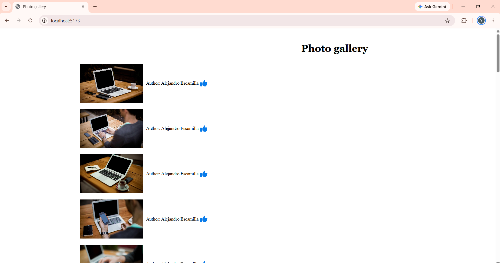
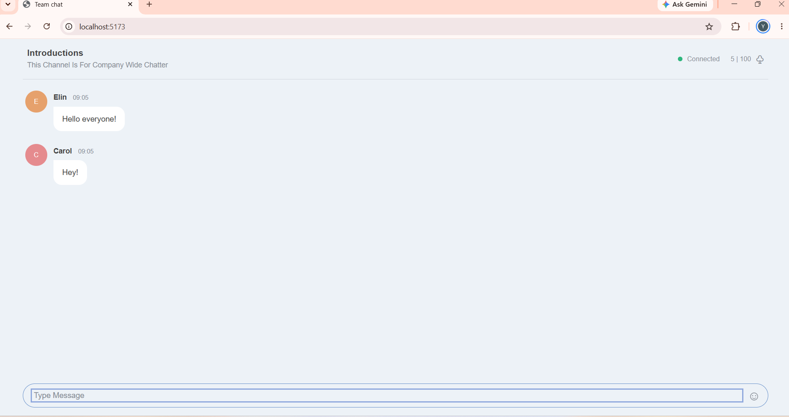

# React Assignments

This repository contains two independent React projects developed as part of application to join Exactspace as a frontent developer intern. Rough summary of features: 

## Projects

### 1. Photo Gallery
A React-based photo gallery featuring:
- Paginated image fetching
- Infinite scrolling
- Image cards
- Like counter
  

### 2. Team Chat
A real-time chat application featuring:
- React frontend
- Express backend
- Socket.IO communication
- Random usernames
- Emoji picker with search
- @mentions

